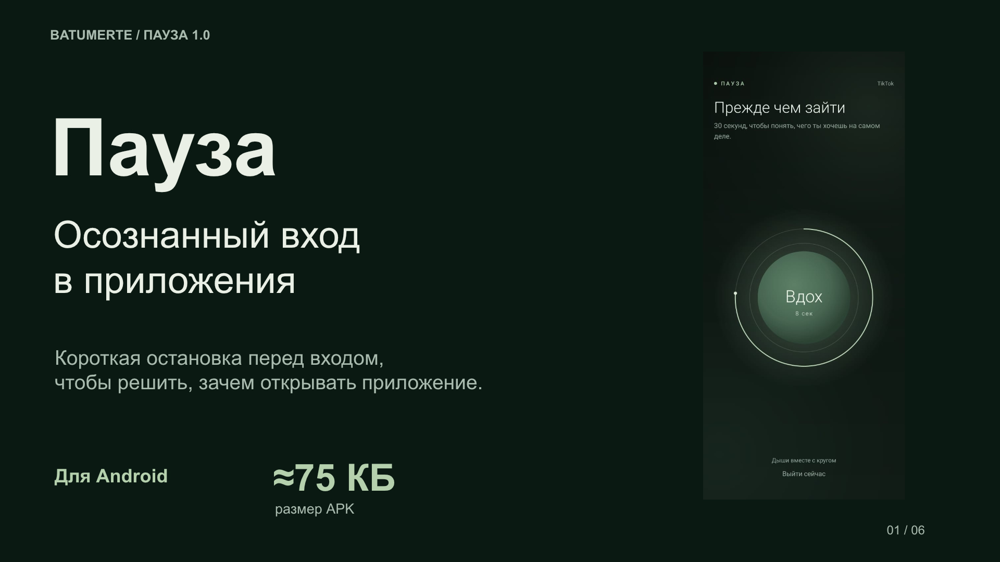

# Пауза · Pause 1.0

Осознанный вход в приложения на Android. «Пауза» предлагает ненадолго остановиться перед открытием выбранного приложения, а затем решить, что делать дальше.

## Скачать

- [Приложение для Android — Pause 1.0 APK](Pause-1.0.apk?raw=true)
- [Презентация — PDF](Pauza-Presentation.pdf)
- [Редактируемая презентация — PowerPoint](Pauza-Presentation.pptx?raw=true)
- [Оригинальные скриншоты — ZIP, 9 изображений](Screenshots.zip?raw=true)

Версия **1.0** · Размер APK **74 808 байт (≈75 КБ)** · Минимальная версия по манифесту: **Android 8.0 (API 26)**.

## Как работает

1. Выберите приложения, перед которыми нужна пауза.
2. Перед входом появится дыхательный экран. На скриншотах установлено 30 секунд; длительность настраивается.
3. После паузы можно войти, включить таймер, записать мысль или выйти.
4. Во время сеанса оставшееся время отображается поверх приложения.
5. По окончании таймера можно выйти, добавить ещё 5 минут или сделать заметку.

Таймер предлагает 1, 3, 5, 10, 15, 20, 30, 45 или 60 минут, а также своё значение. Напоминание на половине предусмотрено для таймеров от 10 минут; есть напоминание за минуту до конца.

## Первый запуск

Скачайте и установите APK на Android. Для определения открытого приложения и показа таймера понадобятся доступ к статистике использования и разрешение отображать поверх других приложений. Настройте их по подсказкам приложения и системы. При необходимости разрешите уведомления и фоновую работу, затем добавьте приложения в список и нажмите «Проверить паузу».

Названия системных настроек могут отличаться в зависимости от телефона.

## Данные и проверка

По описанию автора приложение работает локально, без аккаунтов, аналитики и интернета; заметки и настройки остаются на телефоне. В манифесте приложенного APK отсутствует разрешение `INTERNET`.

Автор проверял приложение на своём смартфоне и несколько раз решил выйти, не открывая ленту TikTok. Это личный опыт, а не результат исследования эффективности.

APK опубликован без изменений. Контрольная сумма доступна в [SHA256SUMS.txt](SHA256SUMS.txt).

## Об этом репозитории

Здесь опубликованы APK, презентация и скриншоты проекта. Исходный код Android-приложения в репозиторий не включён.

## Автор и ссылки

**Batumerte / Mero326 · Electronic**

- [TikTok — @electronicworld12](https://www.tiktok.com/@electronicworld12)
- [Telegram — electronicworld12](https://t.me/m5stiksplus2)

## English

Pause is an Android app that adds a short breathing pause before selected apps. You can continue, start a session timer, write a note, or leave. This repository contains the original version 1.0 APK, a Russian presentation, and screenshots. Android application source code is not included.
